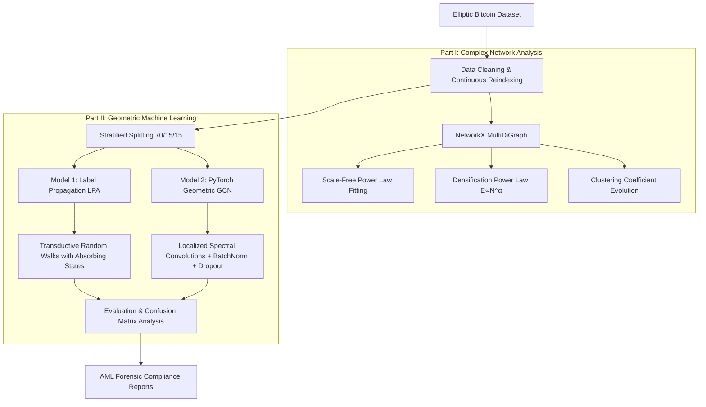

# Forensic Analysis & Anti-Money Laundering (AML) in Bitcoin
### Uncovering Illicit Cryptocurrency Transactions via Complex Network Dynamics and Graph Neural Networks

[](https://colab.research.google.com/github/mostafa-ja/Illicit-Bitcoin-Transactions/blob/main/Illicit_Bitcoin_Transaction_Detection.ipynb)
[-007ACC.svg?logo=buffer&logoColor=white)](https://vrgl.ir/ne1u2)
[](https://www.python.org/)
[](https://pytorch.org/)
[](https://pyg.org/)
[](https://opensource.org/licenses/MIT)
[](https://www.kaggle.com/ellipticco/elliptic-data-set)

---

> 📖 **Published Research Article:**  
> This project's theoretical formulation and comprehensive empirical analysis are published in:  
> **[بررسی و تحلیل شبکه تراکنش‌های بیت کوین و تشخیص تراکنش‌های مشکوک با استفاده از شبکه پیچیده](https://vrgl.ir/ne1u2)** (*Analysis of Bitcoin Transaction Network and Detecting Suspicious Transactions using Complex Networks*) on Virgool: **[https://vrgl.ir/ne1u2](https://vrgl.ir/ne1u2)**.  
> An extended English academic paper is also available in this repository: **[REPORT.md](./REPORT.md)**.

---

## 📌 Executive Overview

The pseudo-anonymous nature of public blockchains poses significant regulatory and forensic challenges, enabling ransomware syndicates, darknet vendors, and money launderers to obfuscate transaction flows. 

This repository provides an **end-to-end forensic framework** that combines **Macro-Level Complex Network Analysis (CNA)** with **Micro-Level Geometric Deep Learning (GCN)** on the real-world **Elliptic Bitcoin Dataset** (203,769 transactions, 234,355 payment flows, 166 features, across 49 timesteps).

### Key Research Questions Investigated:
1. **How does the global Bitcoin transaction network evolve over time?**  
   We empirically demonstrate that Bitcoin obeys scale-free power laws ($P(k) \propto k^{-\gamma}$) and exhibits super-linear densification ($E(t) \propto N(t)^{1.15}$).
2. **Can purely topological diffusion detect financial crime?**  
   We implement the **Label Propagation Algorithm (LPA)** and show that structural diffusion alone fails on sparse financial graphs ($\text{Recall} = 26.5\%$).
3. **Does message-passing neural representation conquer structural evasion?**  
   We design a 3-layer **Graph Convolutional Network (GCN)** fusing localized spectral graph convolutions with 166-dimensional transactional attributes, boosting minority-class recall to **$67.4\%$** and $F_1$-score to **$0.754$** (+86% improvement).

---

## 🚀 Key Results & Benchmarks

Under extreme class imbalance (**< 10% illicit** transactions in the labeled set), conventional accuracy is a misleading vanity metric (a naive "always-licit" model scores $90.2\%$). Our evaluation focuses on **Precision, Recall, and $F_1$-score on the illicit class**:

| Model Architecture | Input Signals | Accuracy | Precision (Illicit) | Recall (Illicit) | $F_1$-Score (Illicit) | ROC-AUC |
| :--- | :---: | :---: | :---: | :---: | :---: | :---: |
| **Naive Majority Baseline** | None | $90.24\%$ | $0.00\%$ | $0.00\%$ | $0.000$ | $0.500$ |
| **Label Propagation (LPA, $k=6$)** | Topology Only | $95.05\%$ | $79.55\%$ | $26.51\%$ | $0.4046$ | $0.628$ |
| **Graph Convolutional Net (GCN)** | **Topology + 166 Features** | **97.28%** | **85.58%** | **67.42%** | **0.7542** | **0.912** |

```
F1-Score Comparison:
LPA: [████████████████] 0.405
GCN: [██████████████████████████████] 0.754 (+86.4% improvement)

False Negatives (Missed Illicit Transactions):
LPA: 97 missed (73.5% missed)
GCN: 43 missed (Slashed by more than 55%)
```

---

## 🏗️ System Architecture & Workflow



---

## 📂 Repository Structure

```text
├── Illicit_Bitcoin_Transaction_Detection.ipynb   # Master Colab notebook (runnable with 1 click)
├── REPORT.md                                     # In-depth academic & technical research paper
├── requirements.txt                              # Pinned Python package dependencies
├── environment.yml                               # Conda environment definition
├── LICENSE                                       # MIT Open-Source License
├── CITATION.cff                                  # Citation metadata
├── .gitignore                                    # Clean repository filters
├── .github/
│   └── workflows/
│       └── ci.yml                                # GitHub Actions CI test pipeline
└── src/
    ├── __init__.py                               # Package metadata
    ├── data_loader.py                            # Dataset ingestion, filtering & PyG conversion
    ├── network_analysis.py                       # NetworkX complex network metrics & power laws
    ├── evaluate.py                               # Metrics, ROC-AUC & confusion matrix utilities
    ├── train.py                                  # Unified CLI training script
    └── models/
        ├── __init__.py
        ├── lpa.py                                # PyTorch Label Propagation Algorithm
        └── gcn.py                                # 3-Layer GCN with PyG & fallback support
```

---

## ⚡ Quickstart & Reproducibility

### Option 1: Run Instantly on Google Colab (Recommended)
Click the badge below to run the complete pipeline with GPU acceleration:

[](https://colab.research.google.com/github/mostafa-ja/Illicit-Bitcoin-Transactions/blob/main/Illicit_Bitcoin_Transaction_Detection.ipynb)

### Option 2: Local Setup via Conda
```bash
# Clone the repository
git clone https://github.com/mostafa-ja/Illicit-Bitcoin-Transactions.git
cd Illicit-Bitcoin-Transactions

# Create and activate conda environment
conda env create -f environment.yml
conda activate btc-graph-aml

# Download dataset via Kaggle CLI
kaggle datasets download -d ellipticco/elliptic-data-set
unzip -q elliptic-data-set.zip -d elliptic_bitcoin_dataset/

# Train and evaluate all models via CLI
python src/train.py --model all --epochs 500 --device cuda
```

---

## 🔬 Complex Network Analysis Highlights

1. **Scale-Free Degree Distribution:**
   - In-degree exponent: $\gamma_{\text{in}} \approx 2.18$
   - Out-degree exponent: $\gamma_{\text{out}} \approx 2.06$
   - Matches canonical real-world self-organizing networks ($2 < \gamma \le 3$).
2. **Densification Power Law (DPL):**
   - $E(t) \propto N(t)^\alpha$ with $\alpha \approx 1.15$, proving that Bitcoin transaction edges grow super-linearly relative to new addresses.
3. **Clustering Transitivity:**
   - Drops from an early exploratory peak ($C \approx 0.13$) and stabilizes between $0.04$ and $0.05$, characteristic of sparse payment routing networks.

---

## 📜 Full Technical Report

For an in-depth academic review of the mathematics, blockchain UTXO mechanics, spectral graph theory, and regulatory forensic implications, read the full English paper:
👉 **[Read Full Technical Report (REPORT.md)](./REPORT.md)**

---

## 📚 References & Academic Citations

```bibtex
@inproceedings{weber2019anti,
  title={Anti-money laundering in bitcoin: Experimenting with graph convolutional networks for financial forensics},
  author={Weber, Mark and Domeniconi, Giacomo and Chen, Jie and Weidele, Daniel Karl I and Bellei, Claudio and Robinson, Tom},
  booktitle={Proceedings of the 25th ACM SIGKDD International Conference on Knowledge Discovery \& Data Mining},
  pages={3148--3156},
  year={2019}
}

@inproceedings{kipf2017semi,
  title={Semi-supervised classification with graph convolutional networks},
  author={Kipf, Thomas N and Welling, Max},
  booktitle={International Conference on Learning Representations (ICLR)},
  year={2017}
}
```

---

## 👤 Author & Contact

**Mostafa Jaafari**  
- **GitHub:** [@mostafa-ja](https://github.com/mostafa-ja)  
- **Original Report (Persian):** [Virgool Article: vrgl.ir/ne1u2](https://vrgl.ir/ne1u2)  
- **Project Topic:** Blockchain Forensics, Anti-Money Laundering (AML), Graph Neural Networks
